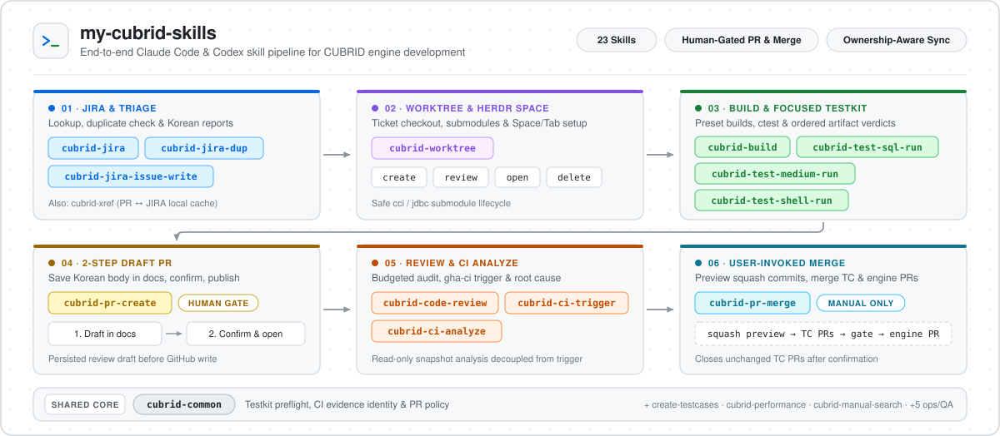

<p align="center">
  <picture>
    <source media="(prefers-color-scheme: dark)" srcset="assets/readme/hero-dark.svg">
    
  </picture>
</p>

<h1 align="center">my-cubrid-skills</h1>

<p align="center">
  <strong>End-to-end Claude Code &amp; Codex skill pipeline for CUBRID database engine development.</strong><br>
  Ticket-first worktrees, native testkit verification, human-gated PRs, CI root-cause analysis, and ownership-aware sync.
</p>

<p align="center">
  <a href="#why-this-exists--end-to-end-workflow">Workflow</a> ·
  <a href="#skills-by-workflow-stage">Skills (17)</a> ·
  <a href="#ci-and-test-skill-layout">CI &amp; Test Layout</a> ·
  <a href="#installation--sync">Installation &amp; Sync</a> ·
  <a href="#usage">Usage</a> ·
  <a href="#prerequisites">Prerequisites</a> ·
  <a href="#general-purpose-skill-migration">Migration</a>
</p>

---

## Why this exists & end-to-end workflow

Engine work on CUBRID spans JIRA triage, multi-submodule worktrees, preset CMake/Ninja builds, three separate native `cubrid-testkit` runners, dual engine + testcase PRs, GitHub Actions diagnostics, and squash merges. Ad-hoc prompts drift across sessions and mix read-only investigation with irreversible mutations.

`my-cubrid-skills` packages those workflows as composable, contract-driven `SKILL.md` modules built around three engineering boundaries:

- **Explicit human gates on external writes**: PR creation ([`cubrid-pr-create`](cubrid-pr-create/SKILL.md)) persists a draft body for review before opening or updating GitHub PRs; final merges ([`cubrid-pr-merge`](cubrid-pr-merge/SKILL.md)) are strictly user-invoked with squash commit previews.
- **Read-only diagnostics decoupled from side effects**: Snapshot CI analysis ([`cubrid-ci-analyze`](cubrid-ci-analyze/SKILL.md)) never triggers workflows, while workflow dispatch ([`cubrid-ci-trigger`](cubrid-ci-trigger/SKILL.md)) enforces duplicate/rerun guards independently.
- **Isolated verification & atomic sync**: Local tests run through native `cubrid-testkit` with ordered artifact verdicts rather than guessed exit codes, and skill installation uses isolated staging with ownership tracking and recoverable pruning.

### End-to-end stage flow

1. **JIRA & Triage**: Inspect tickets (`cubrid-jira` in `vimkim/cubrid-jira`), cross-reference linked PRs (`cubrid-xref` in `vimkim/cubrid-xref`), screen duplicates (`cubrid-jira-dup` in `vimkim/cubrid-jira-duplicate`), and author Korean triage reports ([`cubrid-jira-issue-write`](cubrid-jira-issue-write/SKILL.md)).
2. **Worktree & Herdr Space**: Spin up or clean up ticket-first worktrees with `cubrid-cci`/`cubrid-jdbc` submodules and Herdr Spaces/Tabs (`cubrid-worktree` in `vimkim/cubrid-worktree`).
3. **Build & Focused Testkit**: Configure preset builds and run `ctest` ([`cubrid-build`](cubrid-build/SKILL.md)), then verify focused SQL, medium, or shell cases ([`cubrid-test-sql-run`](cubrid-test-sql-run/SKILL.md), [`cubrid-test-medium-run`](cubrid-test-medium-run/SKILL.md), [`cubrid-test-shell-run`](cubrid-test-shell-run/SKILL.md)).
4. **2-Step Draft PR**: Persist the Korean PR body and resume metadata in `my-cubrid-docs`, review or edit, and publish only after confirmation ([`cubrid-pr-create`](cubrid-pr-create/SKILL.md)).
5. **Review & CI Analyze**: Run budgeted specialist code reviews ([`cubrid-code-review`](cubrid-code-review/SKILL.md)), trigger or rerun `gha-ci` safely ([`cubrid-ci-trigger`](cubrid-ci-trigger/SKILL.md)), and attribute exact-commit failures ([`cubrid-ci-analyze`](cubrid-ci-analyze/SKILL.md)).
6. **User-Invoked Merge**: Preview squash commit messages for the engine PR and linked testcase PRs, merge changed TC PRs, close unchanged ones, refresh the TC gate, and merge the engine PR on confirmation ([`cubrid-pr-merge`](cubrid-pr-merge/SKILL.md)).

---

## Skills by workflow stage

### 1. JIRA & Issue Authoring

| Skill | Purpose |
|-------|---------|
| [`cubrid-jira-issue-write`](cubrid-jira-issue-write/SKILL.md) | Write or revise structured Korean JIRA issue reports for triage |

### 2. Build, Test & Optimization

| Skill | Purpose |
|-------|---------|
| [`cubrid-build`](cubrid-build/SKILL.md) | Prepare, configure, build, install, and run configured `ctest` suites via preset-aware `just` targets |
| [`cubrid-test-sql-run`](cubrid-test-sql-run/SKILL.md) | Run focused SQL cases or narrow SQL subtrees with native `cubrid-testkit` and prove artifact verdicts |
| [`cubrid-test-medium-run`](cubrid-test-medium-run/SKILL.md) | Run complete medium testcase directories serially with native `cubrid-testkit` and verify ordered artifact verdicts |
| [`cubrid-test-shell-run`](cubrid-test-shell-run/SKILL.md) | Run focused shell cases with contained native `cubrid-testkit` and verify artifact verdicts |
| [`create-testcases`](create-testcases/SKILL.md) | Create CUBRID test cases (unit/SQL/shell) for new features or bug fixes |
| [`cubrid-performance`](cubrid-performance/SKILL.md) | Diagnose and optimize CUBRID workloads, engine code, and utilities on Linux with optional baseline comparisons |

### 3. Pull Requests, Review, CI & Merge

| Skill | Purpose |
|-------|---------|
| [`cubrid-pr-create`](cubrid-pr-create/SKILL.md) | Save Korean PR drafts in `my-cubrid-docs` for human review, then create draft PRs or update existing descriptions after confirmation |
| [`cubrid-code-review`](cubrid-code-review/SKILL.md) | Review pinned PRs or diffs with budgeted specialists across C/C++, concurrency, storage I/O, recovery, and HA, with evidence-backed reports and handoffs |
| [`cubrid-ci-trigger`](cubrid-ci-trigger/SKILL.md) | Trigger, rerun, or wait on GitHub Actions `gha-ci` for supported CUBRID PRs with duplicate-cancellation prevention |
| [`cubrid-ci-analyze`](cubrid-ci-analyze/SKILL.md) | Collect exact-commit GitHub Actions evidence with `cubrid-ci`, add testcase-history context, and write failure-analysis reports |
| [`cubrid-pr-merge`](cubrid-pr-merge/SKILL.md) | User-invoked: preview squash commit messages, then merge changed TC PRs, close unchanged ones, refresh the TC gate, and merge the engine PR after confirmation |

### 4. Reference & Operations

| Skill | Purpose |
|-------|---------|
| [`cubrid-manual-search`](cubrid-manual-search/SKILL.md) | Answer CUBRID questions from the local English/Korean RST manual with file-and-line citations |
| [`cubrid-disk-cleanup`](cubrid-disk-cleanup/SKILL.md) | Audit Linux CUBRID home disk usage, enforce live-process/worktree safety checks, and clean approved artifacts by tier |
| [`daily-schedule`](daily-schedule/SKILL.md) | Maintain daily and weekly work plans using `my-cubrid-schedule`, the external `track-work` ledger, and live GitHub/CI state |
| [`my-cubrid-skills-create`](my-cubrid-skills-create/SKILL.md) | Scaffold and register new skills in the `my-cubrid-skills` collection |

### 5. Internal Shared Foundation

| Skill | Purpose |
|-------|---------|
| [`cubrid-common`](cubrid-common/SKILL.md) | Shared workflow policy, user context, native testkit preflight/configuration/verdict logic, CI evidence identity, and helper scripts used internally by other CUBRID skills |

### CLI-bundled skills (migrated)

Standalone CLI and specification skills now live in and install alongside their owning repositories (`just install` / `just sync`):

| Skill | Owning repository | Local checkout / Install |
|---|---|---|
| `cubrid-jira`, `cubrid-jira-kanban-sync` | [`vimkim/cubrid-jira`](https://github.com/vimkim/cubrid-jira) | `~/gh/cubrid-jira` (`just install`) |
| `cubrid-jira-dup` | [`vimkim/cubrid-jira-duplicate`](https://github.com/vimkim/cubrid-jira-duplicate) | `~/gh/cubrid-jira-duplicate` (`just install`) |
| `cubrid-xref` | [`vimkim/cubrid-xref`](https://github.com/vimkim/cubrid-xref) | `~/gh/cubrid-xref` (`just install`) |
| `cubrid-worktree` | [`vimkim/cubrid-worktree`](https://github.com/vimkim/cubrid-worktree) | `~/gh/cubrid-worktree` (`just install`) |
| `cubrid-qa-fetch` | [`vimkim/cubrid-qahome-fetcher`](https://github.com/vimkim/cubrid-qahome-fetcher) | `~/gh/cubrid-qahome-fetcher` (`just install`) |
| `cubrid-oos-context` | [`vimkim/cubrid-oos-context`](https://github.com/vimkim/cubrid-oos-context) | `~/gh/cubrid-oos-context` (`just install`) |
| `workflow-hygiene`, `cubrid-issue-intake`, `cubrid-review-intake` | [`vimkim/my-cubrid-workflow`](https://github.com/vimkim/my-cubrid-workflow) | `~/gh/my-cubrid-workflow` (`just sync`) |

See also `cubrid-ci` in [`vimkim/cubrid-ci`](https://github.com/vimkim/cubrid-ci) (`just install`).

### General-purpose skill migration

The general-purpose skills `gh-pr-comments-all`, `resolve-greptile-comments`, `markdown-write`, and `track-work` moved to [vimkim/my-skills](https://github.com/vimkim/my-skills). Maintain and install them from that collection. `question-socratically` moved there too and is now disabled. `daily-schedule` and `my-cubrid-skills-create` remain here; `daily-schedule` uses the external `track-work` skill. See [docs/general-skills-migration.md](docs/general-skills-migration.md).

---

## CI and test skill layout

| Responsibility | Skill |
|---|---|
| Read-only runtime snapshot and root-cause report | [`cubrid-ci-analyze`](cubrid-ci-analyze/SKILL.md) |
| Authorized one-shot CI trigger and duplicate prevention | [`cubrid-ci-trigger`](cubrid-ci-trigger/SKILL.md) |
| Focused local shell execution | [`cubrid-test-shell-run`](cubrid-test-shell-run/SKILL.md) |
| Focused local SQL execution | [`cubrid-test-sql-run`](cubrid-test-sql-run/SKILL.md) |
| Focused local medium execution | [`cubrid-test-medium-run`](cubrid-test-medium-run/SKILL.md) |
| Build/install and configured `ctest` suite | [`cubrid-build`](cubrid-build/SKILL.md) |
| New behavioral testcases | [`create-testcases`](create-testcases/SKILL.md) |
| Shared native testkit preflight/configuration/verdict, CI evidence identity, and common helpers | [`cubrid-common`](cubrid-common/SKILL.md) |

Snapshot analysis and triggering are independent capabilities; SQL, medium, and shell retain distinct selection and result contracts. Shared native-testkit preparation and CI evidence identity live under [`cubrid-common`](cubrid-common/SKILL.md), not a user-facing coordinator. Runner names stay independent of the current runner implementation.

---

## Installation & sync

### Quick install (`npx skills`)

Uses the [`skills`](https://github.com/vercel-labs/skills) CLI to install globally to `~/.claude/skills/` (and configured agents):

```bash
npx skills add vimkim/my-cubrid-skills -y -g
```

### Local clone & `just` workflow

Clone locally and manage both Claude Code and Codex installations through [`justfile`](justfile):

```bash
git clone https://github.com/vimkim/my-cubrid-skills.git ~/gh/my-cubrid-skills
cd ~/gh/my-cubrid-skills
just sync
```

**Managing:**

```bash
just sync                # Verify current skills, then recoverably prune obsolete owned skills
just sync-dry-run        # Preview additions, conflicts and removals
just list                # List installed skills
just remove cubrid-build # Remove a specific skill
```

### Sync engine, requirements & ownership

Run `just sync` after source updates. It never pulls Git. **Python 3.12+**, **Git**, **just**, **Node 22.20+**, and **npm/npx** are required. The Python standard-library engine invokes `skills@1.7.0` in an isolated staging home, verifies both agent installations, and promotes changes before pruning. Source layout remains top-level `<name>/SKILL.md`.

Ownership lives in `~/.local/state/skill-collections/state.json` and applicable installer metadata. Git history alone never authorizes deletion. Edited or manually managed installations and third-party ownership are preserved; conflicts return `2` while independent eligible installs may proceed. Current conflicts suppress collection pruning. Installer, scan, and verification failures return `1`; missing peer evidence skips pruning and returns `2`. Local legacy copies without ownership evidence require review and backup before explicit replacement.

### Cross-collection migrations (`collection-sync.json`)

[`collection-sync.json`](collection-sync.json) lists both personal collections and the five approved old-to-new transfers. Default paths expect sibling checkouts; for worktrees or another layout pass `just sync --config /absolute/path/config.json` with correct collection paths. Missing peers never imply deletion. Destination-supplied or destination-owned skills remain protected whichever collection synchronizes first. The destination verifies installation and ownership transfer before original source files are removed.

### Recoverable pruning & restore

Removed unchanged owned skills are backed up under `$XDG_STATE_HOME/skill-collections/recovery/removed-*` (default `~/.local/state`). Sync prints the verified recovery location. Restore content, agent links, ownership, and installer metadata without overwriting existing skills:

```sh
just sync-dry-run --restore /absolute/path/to/recovery/removed-XXXX
just sync --restore /absolute/path/to/recovery/removed-XXXX
```

Restore the source directory too before the next normal sync. Explicit `just remove` remains a direct installer action without recovery. Sync does not manage third-party updates.

### Vendored sync engine verification

[`tools/sync_skills.py`](tools/sync_skills.py) is a standalone vendored copy of `vimkim/my-skills/scripts/sync_skills.py`; maintain both copies together. The authoritative engine, public-command tests, and full conflict/recovery documentation are in `my-skills`. Validate byte equality, the old wrapper, and restoration in isolation using:

```bash
python3 ../my-skills/tests/check_vendored_sync.py .
```

Run from this checkout; no live synchronization is part of that check.

---

## Usage

Once installed, invoke skills as slash commands in Claude Code:

```text
/cubrid-pr-create CBRD-26583
/cubrid-ci-analyze https://github.com/CUBRID/cubrid/pull/6864
/cubrid-manual-search What is the default value of max_clients?
/cubrid-performance Make this workload faster; no historical baseline is available
/create-testcases CBRD-26609
```

Skills also trigger automatically based on context.

`cubrid-pr-create` first saves the PR body and resume context in `my-cubrid-docs` for you to read or edit. After you confirm the listed publication steps, it creates a draft PR or updates the existing PR description from that saved body. A detailed explanation is optional.

---

## Prerequisites

Some skills require external CLI tools or runtimes:

| Tool | Required by | Install |
|------|------------|---------|
| `cubrid-worktree` | `cubrid-disk-cleanup` | `just install` in `~/gh/cubrid-worktree` (also installs `cubrid-worktree` skill) |
| `cubrid-jira` | `cubrid-jira-issue-write`, `cubrid-pr-merge` | `just install` in `~/gh/cubrid-jira` (also installs `cubrid-jira` skills) |
| `cubrid-jira-dup` | `cubrid-jira-issue-write` | `just install` in `~/gh/cubrid-jira-duplicate` (also installs `cubrid-jira-dup` skill) |
| `gh` | `cubrid-ci-trigger`, `cubrid-ci-analyze`, `cubrid-pr-create` | [cli.github.com](https://cli.github.com/) |
| `cubrid-ci` | `cubrid-ci-analyze` | `just install` in `~/gh/cubrid-ci` (also installs `cubrid-ci` skill) |
| `testkit` | `cubrid-test-sql-run`, `cubrid-test-medium-run`, `cubrid-test-shell-run` | Manually install the intended `cubrid-testkit` revision with `go install` |
| JDK 8 + CTP assets | `cubrid-test-sql-run`, `cubrid-test-medium-run` | Use the selected worktree environment's configured installations |
| `work-tracker` | `daily-schedule` (uses external `track-work`) | `just install` in `~/gh/work-tracker` |

---

## License

MIT
